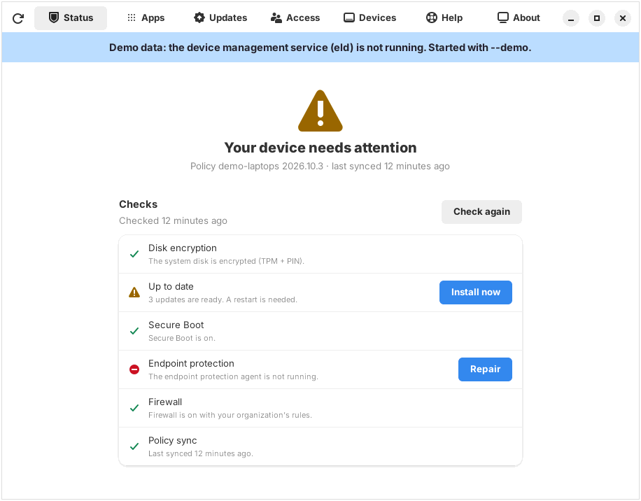

# Workplace: the IT self-service app (skeleton)

**Status:** skeleton. The UI runs, but the control daemon `eld` it talks to is
not built yet, so today it always shows **labelled demo data**. Nothing here
is connected to an MDM, an EDR, or a ticketing system.

Working name **Workplace**, app id `org.enterpriselinux.Workplace`. Design:
[DESKTOP-UX.md §4](../../docs/DESKTOP-UX.md#4-the-it-app-working-name-company-portal--workplace).
API: [CONTROL-API.md](../../docs/CONTROL-API.md).



## Run it

Needs Python 3.10+, GTK 4 and libadwaita 1.4+ (`python3-gi gir1.2-adw-1` on
Ubuntu 24.04, `python3-gobject libadwaita` on RHEL 10 / Fedora).

```sh
cd desktop/workplace
python3 -m workplace --demo                 # demo data
python3 -m workplace --page access          # open on a tab
python3 -m workplace --explain /org/gnome/desktop/session/idle-delay
python3 -m unittest discover -s tests       # tests (no GTK needed)
./install.sh --root /path/to/rootfs         # image build
```

Data source, in order: `--demo` → `WORKPLACE_DEMO=1` → REST over
`/run/eld/api.sock` (override with `WORKPLACE_SOCKET`) if the socket exists →
otherwise demo data with a banner.

## Layout

| Path | What |
|---|---|
| `workplace/api.py` | Control API client, stdlib only. `ControlClient` (task methods), `RestClient` (HTTP over the Unix socket), `DemoClient` (fixed sample data) |
| `workplace/locked.py` | "Managed by your organization" explanations for locked dconf keys |
| `workplace/window.py` | Main window: tabs, demo banner, toasts, dialogs |
| `workplace/pages/*.py` | One module per tab |
| `data/` | `.desktop`, AppStream metainfo, icon |
| `tests/` | unittest for `api.py` and `locked.py` (fake eld on a temp Unix socket) |

## Tabs → Control API

| Tab | Reads | Actions |
|---|---|---|
| Status | `GET /v1/facts/compliance` | `compliance.evaluate`, each check's `fix.action` (e.g. `updates.install-now`, `apps.repair`, `identity.resync`) |
| Apps | `facts/apps` (bundles + catalog), `facts/desktop` (default apps) | `apps.install`, `apps.remove`, `apps.request`, `desktop.set-default-app` |
| Updates | `facts/updates` | `updates.install-now`, `device.reboot`, `updates.defer` |
| Access | `facts/roles` | `roles.request-temporary`, `roles.revoke` |
| Devices | `facts/devices` | `usb.allow-device` |
| Help | `facts/support` | `device.collect-logs`, `support.open-ticket`, `support.start-remote-assist` |
| About | `facts/device`, `facts/os` | — |

### Assumed, not yet in CONTROL-API.md

The API design should adopt or reject these (marked `ASSUMED` in `api.py`):

- Facts: `apps.catalog` (catalog as seen by the calling user), `desktop.default_apps`, `desktop.locked_keys`, providers `devices` and `support`.
- Actions: `apps.request`, `desktop.set-default-app`, `updates.defer`, `roles.request-temporary` (user side of `roles.grant-temporary`), `usb.allow-device`, `support.open-ticket`, `support.start-remote-assist`.

## Next steps

1. Move API calls off the UI thread (`Gio.Task` or a worker thread); today they are synchronous.
2. Subscribe to the event stream (SSE on the socket / D-Bus signals) instead of manual refresh.
3. Use D-Bus `org.enterpriselinux.Control1` once eld exists, so polkit prompts work naturally.
4. Translations (gettext) and RTL check with Hebrew.
5. Pick the final name (DESKTOP-UX open question 2).
